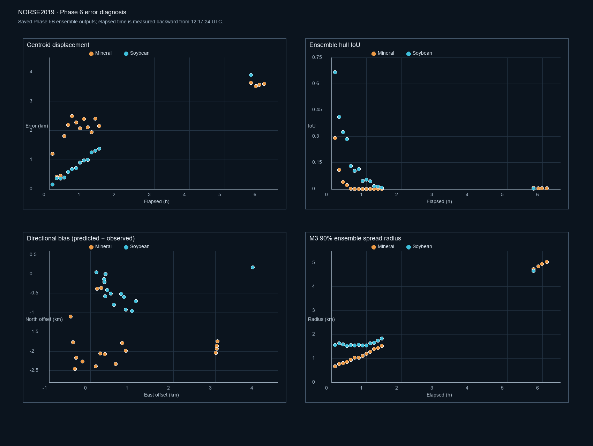

# Phase 6 — NORSE2019 Error Diagnosis

**No tuning or M3 algorithm changes were made.** This diagnosis uses the saved Phase 5B hindcasts, rerun at identical settings only after correcting the validation-output metric handling described below. Both hindcasts still use the checksum-pinned real forcing; no CODE drifters or synthetic fields were used. The forward legs are excluded from every accuracy calculation.

## Error versus elapsed backward time

Elapsed time is measured from each earlier mask timestamp back to the common 12:17:24 UTC endpoint. Error is the EPSG:32631 distance between the mask centroid and M3’s ensemble-median position at the nearest five-minute output time. Maximum time offsets are 136 s for mineral and 127 s for soybean.

| Oil | n | Mean / median / P90 displacement | Pearson r with elapsed time | Spearman r with elapsed time | Mean / median clipped hull IoU | Spearman r of IoU with elapsed time |
|---|---:|---:|---:|---:|---:|---:|
| Mineral | 17 | 2.247 / 2.190 / 3.575 km | 0.838 | 0.792 | 0.028 / 0.000 | -0.339 |
| Soybean | 14 | 0.996 / 0.804 / 1.359 km | 0.991 | 0.996 | 0.158 / 0.078 | -0.991 |

Displacement rises with elapsed backward time for both releases; the trend is especially consistent for soybean. Soybean’s displacement increases from 0.149 km at 0.10 h to 3.903 km at 5.74 h. Mineral errors are 3.51–3.64 km for the earliest four masks, then vary substantially through the later observations. Mineral IoU is low for most earlier masks; soybean IoU falls strongly overall as elapsed time grows, with a few adjacent-time reversals. These correlations are descriptive only: the masks are sequential observations of one slick per oil, not independent samples, so they do not establish statistical significance or generalization.

## Directional bias

Bias is defined as **predicted ensemble median minus observed mask centroid** in UTM 31N. Positive east means the reconstructed position lies east of the mask centroid; negative north means it lies south.

| Oil | Mean east bias | Mean north bias | Direction count across scored masks |
|---|---:|---:|---|
| Mineral | +0.806 km | -1.805 km | east positive 12/17; north negative 17/17 |
| Soybean | +0.812 km | -0.436 km | east positive 14/14; north negative 12/14 |

Mineral has a clear southward offset: all 17 reconstructed medians lie south of their mask centroids, with mean north bias −1.805 km. Its east offset changes sign for some later masks (12 east, 5 west), so the overall +0.806 km east mean is not a stable all-time direction. Soybean has a consistent eastward offset (14/14; mean +0.812 km) and usually a southward offset (12/14; mean −0.436 km). This is a directional pattern in these reconstructed-vs-mask comparisons, not proof that the forcing field itself is biased; mask evolution and seed shape also affect it.

## Ensemble spread and hull meaning

| Oil | Median / maximum M3 90% spread radius | Median / maximum ensemble-hull area | Median observed-mask area | Median per-mask hull:mask area ratio |
|---|---:|---:|---:|---:|
| Mineral | 1.190 / 5.047 km | 3.547 / 76.904 km² | 0.837 km² | 3.46× |
| Soybean | 1.578 / 4.657 km | 4.341 / 65.621 km² | 1.287 km² | 3.41× |

Both spread radius and hull area increase strongly with elapsed time. The ensemble hull is a coarse uncertainty envelope made from only 50 particles, not a slick boundary. Its median area is several times the median observed oil area; at the earliest soybean observation the mask area is only about 0.010 km² while its ensemble hull is about 65.6 km². The hull is therefore useful for visualizing trajectory uncertainty, but it is generally not a physically meaningful estimate of observed slick shape or extent. The one-hour forward forecast was not scored.

## Metric implementation audit

The Phase 5B result files have been corrected and the unchanged-parameter runs repeated:

1. **Mean/median label:** M3’s `EnsembleRun.mean_lon` and `mean_lat` are calculated with `numpy.median`, despite the property names. The saved position is now explicitly labelled ensemble median. The numeric trajectory and centroid displacement did not change.
2. **Unknown raster exterior in IoU:** the earlier overlap calculation counted predicted hull area outside a cropped mask raster as an error. That contradicted the unobserved-outside-footprint rule. The corrected IoU, precision, and recall clip the particle hull to that mask’s full raster bounds before intersecting with its oil pixels. Corrected IoUs differ slightly from the original Phase 5B report; the corrected values are in `validation_results.json` and the CSV.
3. **Raster footprint membership:** an earlier version used the oil polygon’s bounds instead of the whole raster bounds. This has been corrected. Outside-raster particles are excluded from oil-hit denominators and labelled unobserved; inside-raster 0 pixels are oil-free and 1 pixels are oil.
4. **Coordinates and area:** mask pixel centers and particle coordinates are transformed to EPSG:32631 before centroid, hull, and area calculations. The GeoTIFF geotransforms are used directly; no mask-centroid value is treated as a release coordinate.
5. **Time association:** each observation is matched to its nearest saved backward solver time, with a maximum difference under 2 minutes 17 seconds. The seed mask and forward outputs are excluded.
6. **Interpretation caveat:** centroid displacement confounds transport error with slick spreading, fragmentation, and changing mask boundaries. Hull IoU is affected by the 50-particle approximation and by the hull clipping convention. The sequential masks are correlated.

No M3 source or solver setting was changed. The revised runner is `scripts/run_norse2019_obs_hindcast.py`; the error analysis reads its results and does not integrate trajectories.

## Mineral-versus-soybean interpretation

Soybean scored better on these metrics, but the comparison does not show that soybean has intrinsically better modeled drift. M3 uses the same oil-independent surface-advection equations and forcing for both. The main paper reports similar overall drift and similar, though not identical, emulsion viscosities. It also reports that the soybean slick was affected by seabirds, which can alter observed mask extent. Different mask sizes, geometry, release positions, local currents, and raster coverage can therefore explain some apparent difference; this dataset does not isolate their contributions. [Brekke et al., 2021](https://agupubs.onlinelibrary.wiley.com/doi/10.1029/2020JC016499)

## Ranked plausible error sources (hypotheses, not proven causes)

1. **Forcing and omitted wave drift.** Stokes drift is absent by design. The published NORSE mineral-oil simulation used CODE-derived near-surface current, wave-model Stokes drift, and 2% additional measured wind; this run uses NorKyst800 modeled surface current, no waves, and the unchanged 3% M3 windage. That is a material forcing/model mismatch and can plausibly affect displacement and direction. The experiment does not contain a wave-forced control or independent measured drift comparison to attribute the errors to it. [Brekke et al., 2021](https://agupubs.onlinelibrary.wiley.com/doi/10.1029/2020JC016499)
2. **Growing ensemble uncertainty.** M3 assigns per-member current and wind perturbations at run start and holds them throughout the trajectory; the current-noise default is 0.1 m/s, wind noise is 1 m/s (scaled by 0.03 windage), and RK4 adds horizontal diffusion. The saved 90% spread radius grows with elapsed time (Pearson r 1.000 mineral, 0.970 soybean); corresponding hull areas reach 76.9 and 65.6 km². This explains the widening envelope, but does not alone explain the median-path bias.
3. **Surface-current representation and resolution.** The forcing is hourly and regridded from different curvilinear products onto a 0.01° regular grid. Such interpolation can smooth smaller eddies and rapid changes; the available validation does not quantify the resulting current error at the slick locations.
4. **Mask centroid and shape evolution.** The metric follows the centroid of every class-1 pixel, while an advected particle median is a point statistic. The oil slicks elongate, fragment, and change area; the paper also describes different slick signatures and seabird interaction with soybean. A moving/full-mask centroid is not a conserved parcel, so mismatch is not pure trajectory error. [Brekke et al., 2021](https://agupubs.onlinelibrary.wiley.com/doi/10.1029/2020JC016499)
5. **Initial seed approximation and finite ensemble.** The latest raster is reduced to a simplified convex hull for the M3 seed; this fills concavities and may include non-oil gaps. Fifty particles only approximate that boundary, and the convex hull of those particles further fills gaps. This is supported by the hull-to-mask area ratios, but its share of the observed centroid differences is not isolated.
6. **Oil-specific physics.** M3 has no oil-specific viscosity, weathering, entrainment, or spreading evolution. Such physics could affect mask centroids and extents. However, reported viscosities are similar and the paper reports similar overall drift, so the current evidence does not support oil chemistry as the main reason soybean scores better.

## Unsupported conclusions

- No release-origin position or time accuracy: exact release coordinates are unavailable and the evaluation intentionally excludes them.
- No calibrated 95% uncertainty claim: hull overlap and spread have not been calibrated across independent releases.
- No claim that soybean is generally easier to hindcast, or that omitted Stokes drift is the cause of the mineral southward bias.
- No full slick-spread accuracy claim: particle hulls do not simulate oil thickness, spreading, weathering, entrainment, or biological interaction.
- No statistical significance claim from correlations over repeated, serially dependent masks.

## Recommended next experiment

Run a frozen-parameter, independently observed drift check at matched observation times, using a suitable surface drifter only as withheld validation data (never as forcing). First verify that the June 12 iSphere/CODE/SVP observations are available locally and document their depth/sensor behavior. Compare the track against the same MEPS/NorKyst run; if a wave subset is later approved, add it as a separate one-factor experiment without tuning. This can separate path error from slick-shape and footprint effects. Keep the release-origin metric out of scope until an authoritative release coordinate source is obtained.

## Files

- `phase6_error_diagnosis.png` — error, IoU, signed bias, and ensemble spread versus elapsed time.
- `phase6_observation_diagnostics.csv` — all per-observation diagnostic values.
- `phase6_error_diagnosis.json` — descriptive aggregate statistics and per-observation values.
- `validation_results.json` — corrected Phase 5B outputs/configuration/forcing metadata.
- `scripts/diagnose_norse2019_errors.py` — reproducible diagnostics from saved results.
- `scripts/run_norse2019_obs_hindcast.py` — unchanged-settings validation runner.
